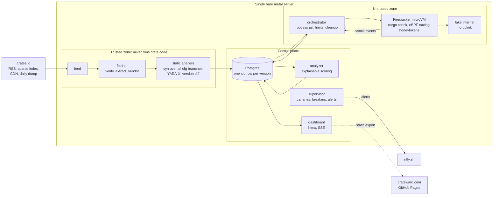

# Crateward

[](https://github.com/janfedler/crateward/actions/workflows/ci.yml)
[](#license)
[](rust-toolchain.toml)
[](https://crateward.com)

Watches crates.io for new versions, analyzes each one statically, runs the
build time code of the interesting ones in a fresh, offline microVM, and
scores the risk with reasons that link to file, line and trace evidence.

## Features

* **Static analysis.** Every new version is parsed and scanned, never run on
  the host.
* **Dynamic analysis.** Build time code runs in a fresh, offline
  Firecracker microVM.
* **Kernel tracing.** eBPF records processes, files and connections.
* **A fake internet.** Every network attempt is answered and recorded.
* **Honeytokens.** Decoy credentials reveal theft.
* **Explainable verdicts.** Every score links to its evidence.
* **Runs unattended.** Retries, breakers, canaries and quarantine.
* **Defense in depth.** Jails, seccomp, Landlock and fuzzing.

## How it works



Each crate version is one job row in Postgres that moves through an explicit
state machine; every service claims work with a lease, so a crashed service
loses nothing. The details, including the state diagram and the network
design, are in [`docs/ARCHITECTURE.md`](docs/ARCHITECTURE.md).

## Workspace

| Crate | What it does |
|-------|--------------|
| [`crateward_core`](crates/core) | Shared types, typed configuration, the job state machine, the Postgres store, sandboxing primitives |
| [`crateward_feed`](crates/feed) | Discovers new versions from the RSS feeds, the sparse index and the daily dump |
| [`crateward_fetcher`](crates/fetcher) | Downloads, verifies, safely extracts and vendors crates |
| [`crateward_static_analysis`](crates/static_analysis) | Parses sources without executing them and produces findings with evidence |
| [`crateward_orchestrator`](crates/orchestrator) | Runs jobs in jailed Firecracker microVMs and guarantees their cleanup |
| [`crateward_guest_agent`](crates/guest_agent) | Runs inside the VM: executes the job offline and streams output and trace to the host |
| [`crateward_guest_ebpf`](crates/guest_ebpf) | The eBPF programs the guest agent loads |
| [`crateward_fake_internet`](crates/fake_internet) | DNS, HTTP and HTTPS sinks that stand in for the internet |
| [`crateward_analyzer`](crates/analyzer) | Scores runs with explainable reasons and keeps behavior profiles |
| [`crateward_supervisor`](crates/supervisor) | Health checks, breakers, canaries, retention and alerts |
| [`crateward_api`](crates/api) | The dashboard: server rendered HTML with htmx and server sent events |
| [`crateward_cli`](crates/cli) | `crateward`, the maintainer's command line tool |
| [`crateward_xtask`](crates/xtask) | Local CI, documentation checks, guest images and release bundles |

## Getting started

### Requirements

* Linux on `x86_64`. The toolchain is pinned in
  [`rust-toolchain.toml`](rust-toolchain.toml); `rustup` installs it with the
  `x86_64-unknown-linux-musl` target.
* PostgreSQL 17 for the database tests. Without it they are skipped.
* For real microVMs only: `/dev/kvm`, subordinate user and group IDs, a
  delegated cgroup and `mkfs.erofs`. Firecracker, the guest kernel and the
  root filesystem are built from pins by `cargo xtask`.

### Build and test

```sh
git clone https://github.com/janfedler/crateward
cd crateward
cargo build --workspace
cargo test --workspace

# With Postgres, the store, feed, CLI and dashboard tests run too:
CRATEWARD_TEST_DATABASE_URL="host=/var/run/postgresql dbname=crateward_test" \
CRATEWARD_REQUIRE_DB=1 cargo test --workspace --all-features

# Every check CI runs, in the same order (needs cargo-deny, cargo-audit
# and cargo-vet):
cargo xtask ci
```

Crate code is never executed outside a microVM, not even in tests: fixture
crates are inert archives, and CI tests the orchestrator against a fake VM
backend. See [`docs/TESTING.md`](docs/TESTING.md).

### Running microVMs

On a host with KVM:

```sh
cargo xtask firecracker     # pinned release, SHA-256 verified
cargo xtask guest-kernel    # pinned kernel source
cargo xtask rootfs          # pinned Debian snapshot, agent as PID 1, eBPF programs
cargo test -p crateward_orchestrator --test firecracker -- --ignored --test-threads 1
cargo xtask soak --jobs 50  # sequential jailed jobs, then a check for leaks
cargo xtask canary          # a crate that steals a honeytoken must be caught
```

## Documentation

* [Architecture](docs/ARCHITECTURE.md) and [threat model](docs/THREAT_MODEL.md)
* [Architecture decision records](docs/adr/README.md)
* [Testing](docs/TESTING.md), [operations](docs/OPERATIONS.md) and [runbook](docs/RUNBOOK.md)
* [Security checklist](docs/SECURITY_CHECKLIST.md) and [disclosure workflow](docs/DISCLOSURE.md)
* [Dependencies](docs/DEPENDENCIES.md), with one line of justification each
* [Deployment](deploy/README.md) and the [launch write up](docs/WRITEUP.md) (draft)

## Security

Crateward runs hostile code for a living, so reports about sandbox escapes,
parser bugs or anything that lets a crate influence the host are especially
welcome. Please report privately through GitHub's private vulnerability
reporting, not in a public issue. Details are in
[`docs/SECURITY.md`](docs/SECURITY.md).

## Contributing

Issues and pull requests are welcome. Before a pull request, run
`cargo xtask ci`; it includes `rustfmt`, `clippy` with the workspace lints,
the tests, the documentation style check and the supply chain checks.
Larger design changes start with an
[architecture decision record](docs/adr/README.md).

## License

Licensed under either of

* Apache License, Version 2.0 ([`LICENSE-APACHE`](LICENSE-APACHE) or
  <https://www.apache.org/licenses/LICENSE-2.0>)
* MIT license ([`LICENSE-MIT`](LICENSE-MIT) or
  <https://opensource.org/licenses/MIT>)

at your option.

The eBPF programs in [`crates/guest_ebpf`](crates/guest_ebpf) are licensed
under the GNU General Public License, version 2 only
([`crates/guest_ebpf/LICENSE`](crates/guest_ebpf/LICENSE)), because the
kernel requires a GPL compatible license for the helpers they call. The
guest agent loads them as a separate object at run time
([ADR 0010](docs/adr/0010-license.md)).

### Contribution

Unless you explicitly state otherwise, any contribution intentionally
submitted for inclusion in the work by you, as defined in the Apache-2.0
license, shall be dual licensed as above, without any additional terms or
conditions. Contributions to `crates/guest_ebpf` are licensed under
GPL-2.0-only.
