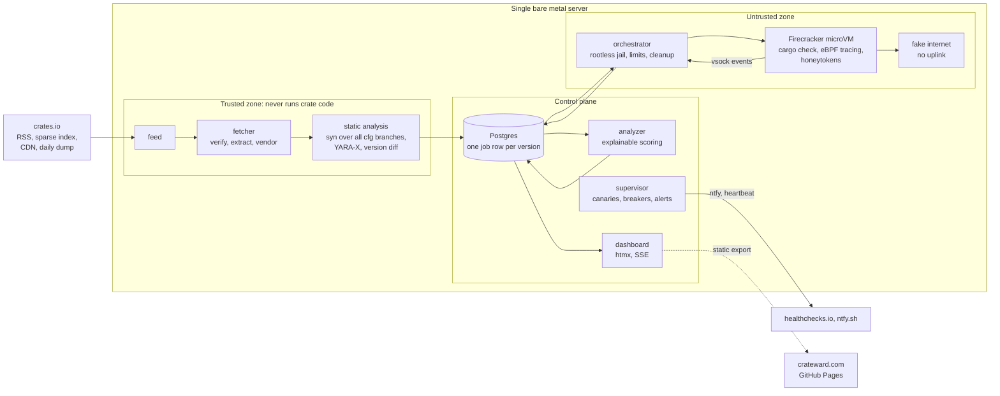

# Crateward

Crateward is an autonomous supply chain scanner for crates.io. It watches for
newly published crate versions, analyzes every one statically, runs the build
time code of the interesting ones inside Firecracker microVMs on a single bare
metal Linux server, scores the risk with reasons that link to evidence, and
shows everything on a web dashboard. It asks its maintainer for help only
when something genuinely needs a human.

> **Status: milestones M0 to M3 are done, M4 is in progress.** New
> crates.io versions become jobs, are fetched, validated and resolved, and
> get a static report with evidence and a triage decision. Versions with
> build time code run `cargo check` in jailed microVMs with honeytokens
> planted and a fake internet that records every network attempt. See
> [the milestones](#milestones).

*A dashboard screenshot will appear here with milestone M6.*

## How it works



The details, including the job state machine and the network design, are in
[docs/ARCHITECTURE.md](docs/ARCHITECTURE.md).

## Goals

* Analyze every new crates.io version statically, including Windows and macOS
  code paths, with file and line evidence for every finding.
* Observe what build scripts, proc macros and dependencies actually do when a
  crate is built on Linux, inside a fresh microVM per job.
* Assume a hostile crate will try to escape, and design so that an escape
  gains nothing: no secrets, no internet, no persistence, no influence on
  later jobs.
* Run unattended. Every failure class has an automated response; the
  maintainer is paged only for a stage that keeps failing, a full disk, KVM
  errors, a canary failure, a high risk verdict, or a sandbox escape
  indicator.
* Label every verdict honestly with what was covered: "dynamic on Linux",
  "static only" with the reason, or "not applicable". Never "clean".
* Disclose responsibly: findings go to the crates.io team and RustSec before
  anything is published.
* Document every decision, test everything that can be tested, and keep the
  build reproducible.

## Non goals

* **Windows, macOS, iOS and Android guests.** Firecracker supports Linux and
  OSv guests only (Firecracker FAQ). macOS licensing requires Apple hardware,
  and iOS cannot be virtualized in any public way. Android guests would
  multiply the image and maintenance work on a single 4 core server. Foreign
  code is type checked with `cargo check` for those targets, never executed.
* **Agentless hypervisor introspection.** Firecracker exposes no guest memory
  introspection API, and building one is a research project of its own. The
  trace source sits behind a trait so it can become phase two
  ([ADR 0003](docs/adr/0003-guest-agent-now-introspection-later.md)).
* **Registries other than crates.io.** One registry done well beats several
  done shallowly, and the data access rules differ per registry.
* **Analyzing every version dynamically.** The hardware cannot keep up with
  the publish rate of crates.io; triage decides, and the dashboard shows the
  coverage.

## Honest limitations

* **Capacity.** With SMT disabled for security, the server has 4 cores, 3 of
  them for microVMs, against roughly 500 new versions per hour at busy times.
  Most versions will be labeled "static only", with the reason.
* **Evasion.** A crate can detect the sandbox and stay dormant. Host side
  ground truth (tap capture, disk diffs) limits what an active crate can
  hide, not what a dormant one never does.
* **Host kernel.** The server runs Debian 13's stock 6.12 kernel, which is
  outside Firecracker's validated host kernel matrix (5.10, 6.1, 6.18). The
  soak test and hourly canaries on the running kernel compensate
  ([ADR 0007](docs/adr/0007-ansible-on-debian.md)).
* **No ECC memory.** The CPU does not support it. Durable data is protected
  by end to end checksums; results in flight are not.
* **One server.** There is no redundancy. An outage pauses scanning; the
  external heartbeat reports it.

## Quick start

Crateward is at milestone M0, so the quick start covers development only.

```sh
git clone https://github.com/janfedler/crateward
cd crateward
# The toolchain is pinned in rust-toolchain.toml; rustup installs it.
cargo xtask ci          # every check CI runs, in the same order
cargo run -p crateward_cli -- config check --config config/crateward.example.toml
cargo run -p crateward_cli -- state-machine diagram
```

`cargo xtask ci` expects `cargo-deny`, `cargo-audit` and `cargo-vet` on the
`PATH`. Deployment instructions follow with milestone M8 in
[docs/OPERATIONS.md](docs/OPERATIONS.md).

## Milestones

| Milestone | Scope | State |
|-----------|-------|-------|
| M0 | Foundation: workspace, CI, config, core types, state machine, docs | done |
| M1 | Firecracker platform: guest kernel and rootfs, orchestrator, rootless jail, limits, cleanup | done |
| M1.5 | Build cache warmer: prewarmed snapshot and read only sccache, measured | done: warm target image from replayed dependency builds, 28% less run time measured (ADR 0008) |
| M2 | Ingest: feed, fetcher, safe extraction, vendoring, content addressed store | done |
| M3 | Static analysis: findings with evidence, cfg coverage, diffs | done |
| M4 | Dynamic analysis: guest agent, events, fake internet, honeytokens, ground truth | done: VM runs, eBPF trace, fake internet with TLS and packet capture, honeytokens, scratch disk scan; cross target checks later |
| M5 | Autonomy: scheduler, retries, breakers, reconciliation, canaries, alerts | done: breakers, quarantine, pauses, canaries, deadlines, alerts, heartbeat (ADR 0020) |
| M6 | Analyzer and web: scoring, profiles, dashboard, public export | planned |
| M7 | Hardening and storage: security checklist, fuzzing, retention, measured budget | planned |
| M8 | Launch: deployment, runbook, disclosure workflow, write up | planned |

## Documentation

* [Architecture](docs/ARCHITECTURE.md) and [threat model](docs/THREAT_MODEL.md)
* [Security policy](docs/SECURITY.md) and [disclosure workflow](docs/DISCLOSURE.md)
* [Runbook](docs/RUNBOOK.md), [operations](docs/OPERATIONS.md) and [testing](docs/TESTING.md)
* [Dependencies](docs/DEPENDENCIES.md), one line of justification each
* [Architecture decision records](docs/adr/README.md)

## License

Not chosen yet. Until the maintainer picks one, all rights are reserved and
every package is marked `publish = false`.
