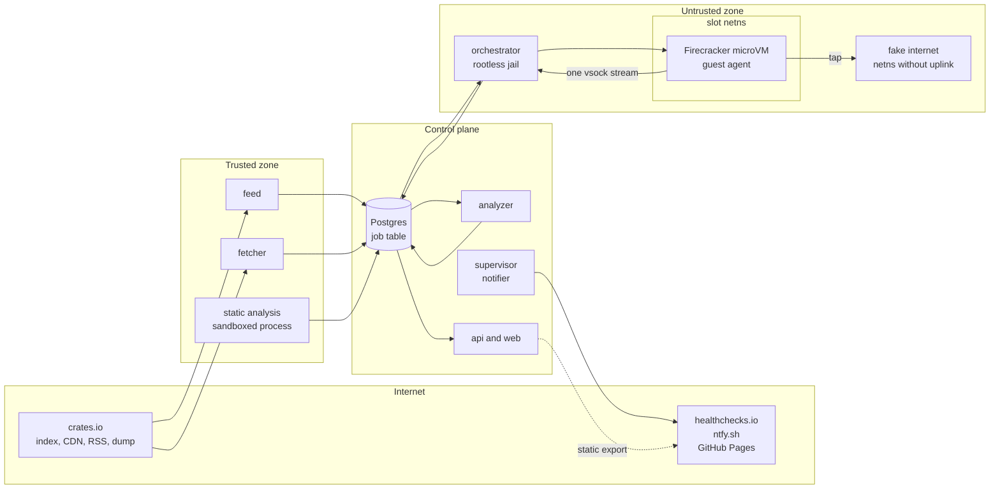
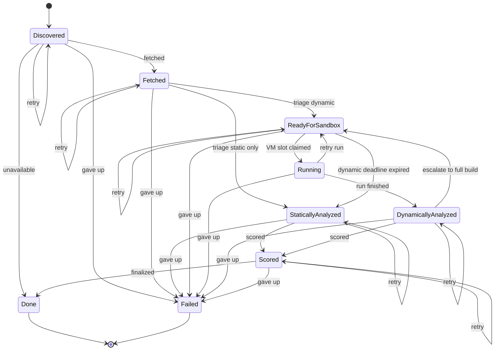

# Architecture

This document describes how Crateward is put together and why. Decisions with
real alternatives are recorded in [the ADR folder](adr/README.md); this page
links to them instead of repeating them.

## Goals in one paragraph

Crateward watches crates.io for new versions, analyzes each one statically,
runs the build time code of the interesting ones inside Firecracker microVMs,
scores the risk with reasons linked to evidence, and shows the results on a
dashboard. It runs unattended on one bare metal server and interrupts the
maintainer only for the closed list of reasons in
`crateward_core::escalation`.

## Hardware and its consequences

The production server is fixed: an Intel Core i7-7700 (4 cores, 8 threads),
64 GiB RAM without ECC, and two 2 TB enterprise HDDs, hosted at Hetzner. Three
consequences shape everything below.

* **SMT is disabled.** The i7-7700 is affected by L1TF and MDS. The kernel
  documentation calls `mds=full,nosmt` "the complete mitigation" and states
  that preventing the SMT issues of L1TF "might" require disabling SMT
  completely. With SMT off the server has 4 cores: 1 for host services and 3
  for microVMs. See [ADR 0010](adr/0010-smt-off-and-ram-hot-path.md).
* **The hot path lives in RAM.** Spinning disks cannot serve the random reads
  of snapshot memory files or the writes of scratch disks. Promoted images
  and per job scratch disks live in tmpfs; the HDDs hold durable data.
* **No ECC, plain ext4.** The disks are an md RAID1 with ext4, unencrypted
  ([ADR 0013](adr/0013-ext4-on-md-raid-without-encryption.md)). Neither
  checksums data, so Crateward does: content addressed blobs are verified
  by their BLAKE3 digest on every read, images by BLAKE3 manifests, crate
  files by the index SHA-256, and PostgreSQL pages by data checksums.

## Zones

The server is split into three zones plus the guest. A component's zone
decides what it may touch. `crateward_core::component` encodes this mapping
and a unit test checks that only the guest executes crate code.

| Zone | Components | Executes crate code | Internet |
|------|------------|---------------------|----------|
| Trusted | feed, fetcher, static analysis | never | crates.io hosts only (fetcher) |
| Untrusted | orchestrator, warmer, fake internet | only inside microVMs | none |
| Control plane | analyzer, api, supervisor, cli, Postgres | never | alert and heartbeat services, GitHub (export) |
| Guest | guest agent, crate under analysis | yes | none; the fake internet only |

## Data flow

One Postgres row per crate version tracks the whole pipeline. Every stage
claims rows in its input state with `SELECT ... FOR UPDATE SKIP LOCKED`,
holds a lease renewed by heartbeats, performs an idempotent step, and reports
an event to the state machine. See [ADR 0004](adr/0004-postgres-as-queue.md).

1. **feed** sees a new version in the RSS feeds, confirms it in the sparse
   index, and creates the job. The daily database dump reconciles anything
   the feeds missed and provides the popularity data behind priorities.
2. **fetcher** downloads the `.crate` file, verifies its SHA-256 against the
   index, validates the archive in a sandboxed child without extracting it,
   resolves all dependencies for all targets with `cargo generate-lockfile`
   on a generated consumer probe (sandboxed, no compiler), fetches and
   validates every locked crate, and stores them as content addressed blobs
   ([ADR 0014](adr/0014-resolve-fetch-validate.md)).
3. **static analysis** parses every Rust file with `syn` across all `cfg`
   branches in a sandboxed child, runs detectors and YARA-X rules, diffs
   against the previous version, and decides the triage: dynamic, static
   only, or not applicable on Linux
   ([ADR 0015](adr/0015-static-analysis-and-triage.md)).
4. The job becomes ready for the sandbox, or goes straight to scoring.
5. **orchestrator** claims the job when a VM slot is free, builds the job's
   read only payload image and scratch disk, restores the base snapshot,
   points its placeholder drives at them, and has the agent mount them and
   plant fresh honeytokens
   ([ADR 0016](adr/0016-dynamic-runs-payload-fake-internet-honeytokens.md)).
6. **guest agent** runs `cargo check` as an unprivileged user and streams
   its output and an eBPF trace (processes, file opens, connections, tamper
   attempts; [ADR 0017](adr/0017-ebpf-tracing-in-the-guest.md)) over the
   single vsock connection. The fake internet records every network attempt
   as host side ground truth, including frames no proxy sees
   ([ADR 0018](adr/0018-frames-the-proxies-do-not-see.md)), and after the
   run the host reads the scratch disk in a sandboxed child
   ([ADR 0019](adr/0019-scratch-disk-scan.md)). Planned: cross target
   checks where the crate has platform specific code.
7. **analyzer** scores static findings, dynamic events and the version diff,
   may escalate once to a full build and test, and stores a behavior profile.
8. **analyzer** finalizes: high and critical verdicts wait in the "needs
   you" inbox of the dashboard (**api**), the **supervisor** raises alerts
   from the closed escalation list, and the api exports aggregate numbers
   to the public site
   ([ADR 0021](adr/0021-explainable-scoring.md),
   [ADR 0022](adr/0022-dashboard-and-public-export.md)).

## Job state machine

The state machine lives in `crateward_core::job` as a pure function. The
diagram below is generated from that function by
`cargo xtask state-diagram --write`, and CI fails if it drifts.

<!-- BEGIN GENERATED: job state diagram, run `cargo xtask state-diagram --write` -->

<!-- END GENERATED: job state diagram -->

Notes on the design:

* States name what has been achieved. Each stage claims the state its
  predecessor produced. `Running` is the exception: a VM run owns host
  resources (slot, tap device, jail) that startup reconciliation must match
  against rows.
* `DynamicallyAnalyzed` is one state more than the specification lists. It
  stores raw VM results before scoring, so an analyzer crash never forces an
  expensive, non deterministic VM rerun.
* "retry" edges keep the stage and consume one attempt (transient failure or
  expired lease) or one infrastructure retry. Attempts reset only when a
  stage completes. A run that fails after the VM started goes back to the
  slot queue with its attempts intact, so it cannot loop forever.
* An expired lease counts as a failed attempt because a hostile crate can
  crash a worker on purpose.
* A suspected compromise ends the job in `Failed` and puts the pipeline into
  quarantine, in the same transaction. The job is never retried
  automatically, since that would execute the suspicious crate again.
* Infrastructure failures feed a circuit breaker per stage; an open breaker
  or a pause (quarantine, a failed canary, a full scratch filesystem) stops
  claiming in the affected stages only. The supervisor decides from the job
  events and delivers alerts
  ([ADR 0020](adr/0020-autonomy-breakers-quarantine-canaries-alerts.md)).
* A crate that fails to build is a result (`BuildOutcome::Failed`), not a
  failure of the pipeline.
* Escalation to a full build and test happens at most once. Together with
  bounded retries this makes every path finite; a property test checks it.

## Triage and capacity

Crates.io publishes on the order of 500 versions per hour at busy times (one
sample from the RSS feed on 2026-09-24: 514 versions in 60 minutes). Three
vCPUs cannot run all of them, so:

* every version gets static analysis;
* a version gets a VM run only if it has build time code of its own (a build
  script, `proc-macro = true`, or `links`), has a high severity finding, or
  locks an unfamiliar dependency with build time code
  ([ADR 0015](adr/0015-static-analysis-and-triage.md));
* new crates and updates of popular crates get a higher priority, so they
  run first;
* a job that waits longer than `triage.dynamic_deadline_hours` for a slot is
  scored as static only, and its label says why;
* the dashboard publishes the share of versions with dynamic results.

A version whose own code has no build time component executes nothing of its
own during `cargo check`, so labeling it "static only, no build time code"
loses little. Its dependencies' build scripts are analyzed as their own
versions.

## MicroVM lifecycle

The orchestrator drives Firecracker 1.17 through its API socket and always
starts it in a rootless jail ([ADR 0012](adr/0012-rootless-jail.md)).

* **No root.** A single threaded launcher, `crateward-vmjail`, joins the
  slot's cgroup, creates a user namespace in which the slot's own
  subordinate UID stands for Firecracker, then mount, network, IPC and UTS
  namespaces; bind mounts exactly the kernel, the images and `/dev/kvm`;
  creates the slot's tap device; `pivot_root`s; drops every capability;
  sets `no_new_privs`; and executes Firecracker, whose own seccomp filter
  then applies. Namespaces and tap devices die with the process.
* **Restore, then personalize.** Jobs restore a Full snapshot of a clean boot
  (Diff snapshots are a developer preview). Firecracker's documentation calls
  resuming one snapshot many times insecure for uniqueness, so the job
  identity, honeytokens and wall clock are sent over vsock after restore,
  and the guest waits for the VMGenID reseed. `PUT /snapshot/load` supports
  `network_overrides` and `vsock_override`, and each jail provides the same
  relative paths the snapshot expects.
* **Payload.** The host builds a read only EROFS image of the job's vendored
  sources in tmpfs and swaps it in with `PATCH /drives/{id}` after restore.
  The warm build cache is a third drive, switched the same way; inside the
  guest, overlayfs stacks its target directory under the job's own
  writable layer.
* **One channel.** The host initiates the only vsock connection
  (`CONNECT <port>`). It never listens on `<uds_path>_<port>`, so every guest
  initiated vsock connection is refused by Firecracker.
* **Limits.** cgroup v2 `cpu.max`, `memory.max` and `pids.max`; Firecracker
  rate limiters on drives and the network device; a fixed size scratch disk;
  a wall clock limit enforced with `cgroup.kill`.
* **Cleanup.** Every resource is named after its slot. On startup the
  supervisor kills orphan VMs, removes stale tap devices, namespaces, jails
  and scratch files, and verifies free disk space.

## Network

Each slot has its own network namespace, created by the rootless jail. All
clones share the guest IP (`10.0.2.2`) and MAC address baked into the
snapshot, which works because the namespaces are isolated. The namespace
holds only the tap device (`10.0.2.1` on the host side) and one fake
internet process, which runs as the slot's user without filesystem access.
There is no uplink and no route out, so a guest cannot reach the real
internet at all. nftables in the namespace redirects every DNS query, TCP
connection and UDP datagram to the fake internet, which recovers the
intended TCP destination with `SO_ORIGINAL_DST` and logs each attempt with
its first 64 KiB. That log is read after the run as ground truth and
searched for the job's honeytokens
([ADR 0016](adr/0016-dynamic-runs-payload-fake-internet-honeytokens.md)).
TLS is terminated with Crateward's own authority, which the guest image
trusts, so the content of HTTPS requests is logged too. IPv6 logging is
still open.

## Build cache

At startup the orchestrator replays the dependency builds of recent jobs in
a VM, with each crate under analysis replaced by a stub, and packs the
resulting target directory into a read only image. Every job then mounts it
under its own writable layer and compiles only what the image lacks. Only
versions Crateward has stored for two weeks, seen in several jobs and found
without high severity static findings enter it; the warm build is analyzed
like a job and a promotion check guards its use. In the measurement, run
time fell by 28 percent. See
[ADR 0008](adr/0008-prewarmed-snapshot-and-shared-sccache.md).

## Storage layout

| Location | Medium | Contents |
|----------|--------|----------|
| `/boot` | md RAID1 | kernel and initramfs |
| `/` and `/var/lib` | ext4 on md RAID1, unencrypted | Postgres, content addressed store, evidence, logs, image archive |
| `/run/crateward/images` | tmpfs | promoted images, verified by BLAKE3 on copy |
| `/run/crateward/scratch` | tmpfs with a hard cap | per job scratch disks (sparse files) |

## Egress

Every allowlist is enforced per service user by nftables sets that are filled
from DNS.

| Service user | Destinations | Purpose |
|--------------|--------------|---------|
| fetcher | `index.crates.io`, `static.crates.io`, `cloudfront-static.crates.io` | index, crate files, dump |
| feed | `static.crates.io`, `index.crates.io` | RSS feeds, index files |
| image builder (weekly) | `static.rust-lang.org`, `snapshot.debian.org`, kernel source | guest image, pinned by hash |
| supervisor | `ntfy.sh`, `hc-ping.com` | alerts and heartbeat |
| exporter | `github.com` | one way push of the public site |
| everything else | none | |

The only inbound path is WireGuard on one UDP port, which sends nothing in
response to unauthenticated packets. See
[ADR 0009](adr/0009-single-server-with-external-services.md).

## Package map

| Package | Zone | Milestone |
|---------|------|-----------|
| `crateward_core` | shared | M0 |
| `crateward_feed` | trusted | M2 |
| `crateward_fetcher` | trusted | M2 |
| `crateward_static_analysis` | trusted | M3 |
| `crateward_orchestrator` | untrusted | M1, warmer in M1.5 |
| `crateward_guest_agent` | guest | M4 |
| `crateward_guest_ebpf` (GPL-2.0-only, own workspace) | guest | M4 |
| `crateward_fake_internet` | untrusted | M4 |
| `crateward_analyzer` | control plane | M6 |
| `crateward_api` | control plane | M6 |
| `crateward_supervisor` | control plane | M5 |
| `crateward_cli` | control plane | grows with each milestone |
| `crateward_xtask` | development | M0 |
